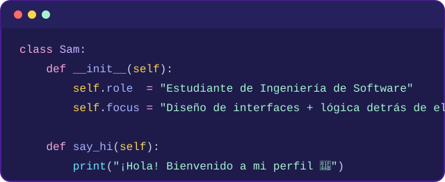
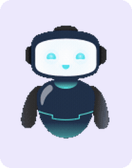

<!-- Banner de bienvenida animado (capsule-render) -->

<!-- Texto tipo máquina de escribir -->

---

### Sobre mí

<table>
<tr>
<td width="65%" valign="middle">

- 🔬 **Enfoque técnico:** Calidad de software (testing), modelado matemático y diseño de interfaces intuitivas.
- 💬 **Hablemos de:** Desarrollo de sistemas, seguridad informática, buenas prácticas de código o metodologías de diseño.

</td>
<td width="35%" align="center" valign="middle">

<picture>
  <source media="(prefers-color-scheme: dark)" srcset="robot-oscuro.gif">
  <source media="(prefers-color-scheme: light)" srcset="robot-claro.gif">
  
</picture>
 
<i> Siempre aprendiendo... </i>

</td>
</tr>
</table>

---

### Stack de tecnologías

**Frontend & UI**

**Backend & Datos**

**Hardware & IoT**

**Herramientas**

---

### Estadísticas de GitHub

<a href="https://github.com/vn7n24fzkq/github-profile-summary-cards"><picture><source media="(prefers-color-scheme: dark)" srcset="https://raw.githubusercontent.com/gely25/gely25/main/profile-summary-card-output/tokyonight/0-profile-details.svg"><source media="(prefers-color-scheme: light)" srcset="https://raw.githubusercontent.com/gely25/gely25/main/profile-summary-card-output/default/0-profile-details.svg"></picture></a>

<a href="https://github.com/vn7n24fzkq/github-profile-summary-cards"><picture><source media="(prefers-color-scheme: dark)" srcset="https://raw.githubusercontent.com/gely25/gely25/main/profile-summary-card-output/tokyonight/1-repos-per-language.svg"><source media="(prefers-color-scheme: light)" srcset="https://raw.githubusercontent.com/gely25/gely25/main/profile-summary-card-output/default/1-repos-per-language.svg"></picture></a>
<a href="https://github.com/vn7n24fzkq/github-profile-summary-cards"><picture><source media="(prefers-color-scheme: dark)" srcset="https://raw.githubusercontent.com/gely25/gely25/main/profile-summary-card-output/tokyonight/2-most-commit-language.svg"><source media="(prefers-color-scheme: light)" srcset="https://raw.githubusercontent.com/gely25/gely25/main/profile-summary-card-output/default/2-most-commit-language.svg"></picture></a>

<a href="https://github.com/vn7n24fzkq/github-profile-summary-cards"><picture><source media="(prefers-color-scheme: dark)" srcset="https://raw.githubusercontent.com/gely25/gely25/main/profile-summary-card-output/tokyonight/3-stats.svg"><source media="(prefers-color-scheme: light)" srcset="https://raw.githubusercontent.com/gely25/gely25/main/profile-summary-card-output/default/3-stats.svg"></picture></a>
<a href="https://github.com/vn7n24fzkq/github-profile-summary-cards"><picture><source media="(prefers-color-scheme: dark)" srcset="https://raw.githubusercontent.com/gely25/gely25/main/profile-summary-card-output/tokyonight/4-productive-time.svg"><source media="(prefers-color-scheme: light)" srcset="https://raw.githubusercontent.com/gely25/gely25/main/profile-summary-card-output/default/4-productive-time.svg"></picture></a>

### 🐍 Serpiente de contribuciones

<!-- Cambia automáticamente según el tema claro/oscuro del visitante -->
<picture>
  <source media="(prefers-color-scheme: dark)" srcset="https://raw.githubusercontent.com/gely25/gely25/output/github-contribution-grid-snake-dark.svg">
  <source media="(prefers-color-scheme: light)" srcset="https://raw.githubusercontent.com/gely25/gely25/output/github-contribution-grid-snake.svg">
  
</picture>

---

